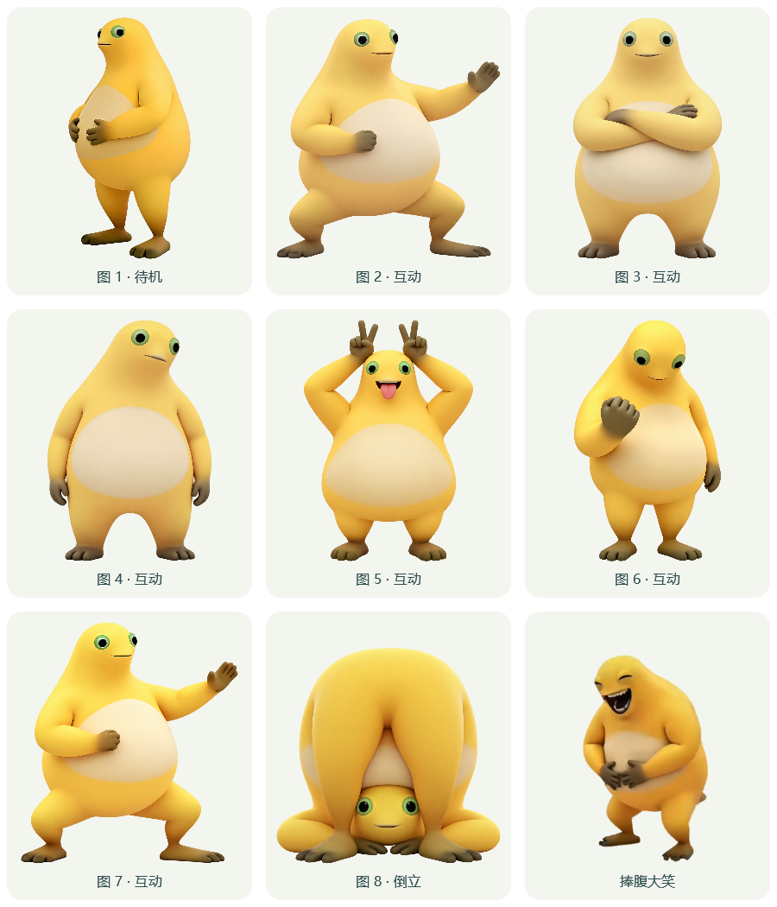

# 奶娃桌宠

一个可以点击互动、拖动换姿势的 Windows 透明桌宠。待机时捧着肚子，点一下就换个动作；大笑采用 144 张连续视频帧，以 30 fps 播放约 4.8 秒。


## 直接使用

如果仓库提供了 Releases，在 Releases 页面下载 EXE，双击运行即可。运行前先右键退出旧版奶娃，避免同时打开多个版本。

- 单击：依次切换图 2–7、折腰倒立和捧腹大笑。
- 拖拽：移动奶娃，同时轮换普通姿势。
- 滚轮：调整大小。
- 右键：直接选动作，调整呼吸、置顶、大小，隐藏或退出。
- 托盘：双击图标找回隐藏的奶娃。

互动结束后会自动回到图 1 待机。位置、大小等设置会在本机记住。



## 从源码编译

需要 Windows，以及系统中的 .NET Framework 4.x 编译器。无需安装 Python、Node.js 或第三方依赖。

1. 下载并解压本仓库，进入包含 `README.md` 和 `build.ps1` 的文件夹。
2. 在文件夹地址栏输入 `powershell` 并回车。
3. 运行：

```powershell
powershell -NoProfile -ExecutionPolicy Bypass -File .\build.ps1
```

构建完成后，双击 `dist\NaiwaDesktopPet.exe`。EXE 已内嵌素材，单独复制这一个文件也可以运行。

源码编译默认不含参考视频原声，可自行添加 `assets/laugh_sound.mp4` 后重新构建。该可选文件只用于本机构建，已在 `.gitignore` 中排除。加入资源后，原声仍默认关闭，可在右键菜单“参考视频原声”开启。此前提供的完整版 EXE 含原声资源。

## 文件说明

```text
README.md                  项目介绍和使用说明
build.ps1                  默认构建入口
src/Naiwa.cs                桌宠源码
src/build.ps1               编译与素材嵌入脚本
assets/pose1.png ... pose8.png
assets/laugh_frames.zip     144 张透明动画帧及 animation.txt
docs/preview.gif            大笑动作预览
docs/poses.png              九种姿势预览
docs/animation-format.txt   动画配置格式
```

动画帧集中放在 `assets/laugh_frames.zip` 中，方便通过 GitHub 网页一次上传整个项目。构建脚本会自动解压到临时目录，编译后清理，不需要手动解压。

EXE 建议放在 GitHub Releases，源代码和素材放在仓库中。`dist/`、构建临时文件和本机设置不会进入源码提交。

## 检查构建结果

在项目文件夹中运行以下命令，可检查素材、互动顺序、原生帧时序与自动回待机行为。检查过程不会显示桌宠或播放原声。

```powershell
New-Item -ItemType Directory -Force .\build | Out-Null
Start-Process -FilePath .\dist\NaiwaDesktopPet.exe -ArgumentList '--smoke-test','build\smoke.json' -WindowStyle Hidden -Wait
Get-Content .\build\smoke.json
```

结果中的 `ok: true` 表示检查通过；`laugh` 会显示 144 帧、30 fps、4.8 秒及原生帧播放配置。
